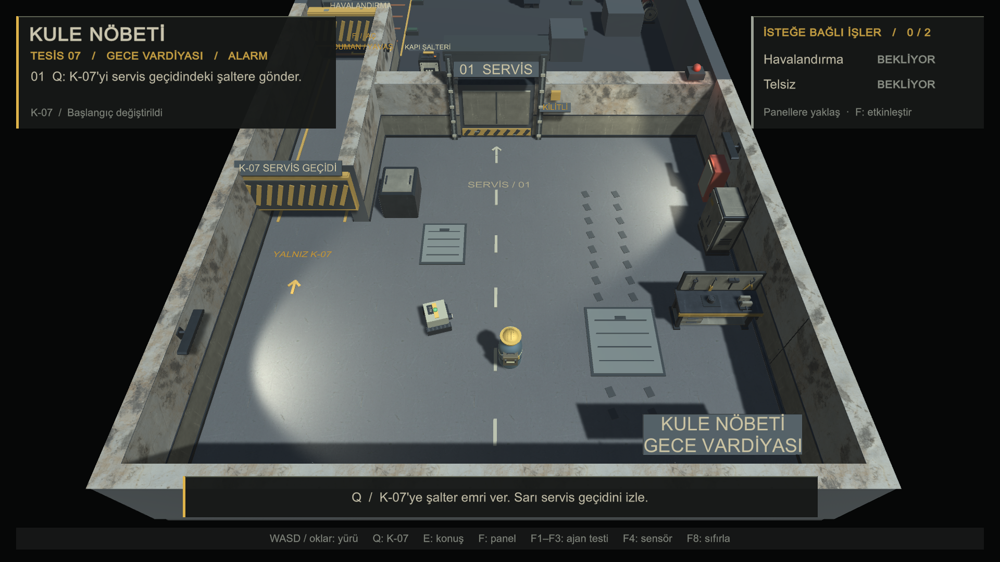
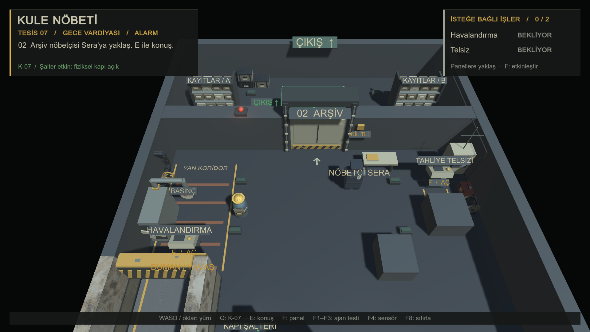
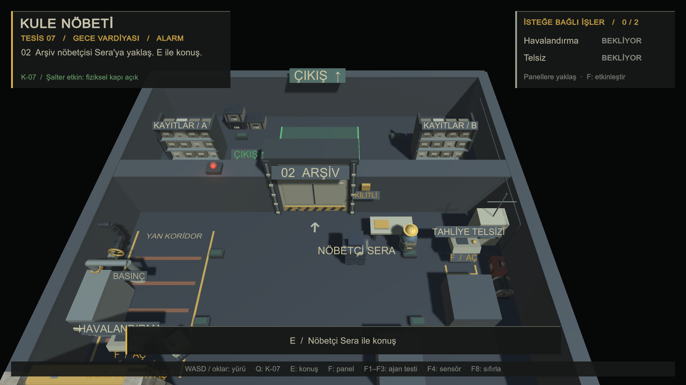
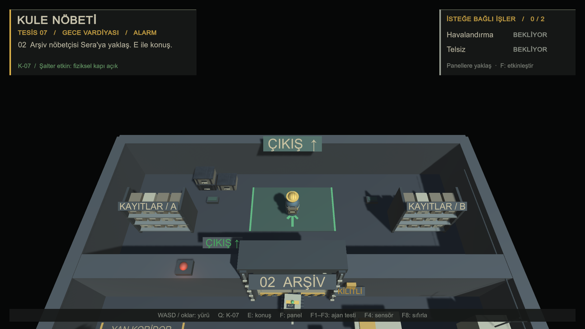

# Karakterler ve işlevli tesis ekipmanı

Bu tur, önceki servis odasının beton, boyalı metal, elektrik panosu ve çalışma ışıklarını koruyarak mevcut karakterlere kıyafet/ekipman ayrıntıları ve duvar kenarlarına işlevli tesis eşyaları ekler. Sahne hâlâ `Assets/Scenes/KuleNobeti.unity` içinde çalışma anında üretilir.

## Unity'de görülecekler

- Başlangıçta oyuncunun bakım tulumu, baret, reflektif şeritleri ve küçük alet çantası; K-07'nin alçak gövdesinde çalışma farı ve servis etiketi.
- İlk odanın doğu duvarında bakım tezgâhı ve alet dolabı. Orta yürüyüş yolu, zemin kapakları, batıdaki tünel ağzı ve şalterin önü boş kalır.
- İlk kapıdan sonra solda havalandırmanın yanında boru/izolasyon vanası; sağdaki telsizin yanında kablo makarası ve acil durum çantası.
- Arşiv önünde Sera'nın koyu üniforması, omuz telsizi ve yaka kartı; arşivin kuzey duvarı boyunca birkaç dosya taşıma kasası.

Projede yeniden taranan kullanılabilir FBX/OBJ/BLEND, insan prefab'ı veya animasyon bulunmadı. Bu yüzden mevcut insan gövde ve başları yeniden yapılmadı: aynı rendererlara renk verildi ve görsel çocuk nesnelerle kıyafet/ekipman eklendi. Yeni insan modeli, iskelet veya animasyon eklenmedi.

## Dosyalar ve kaynaklar

- `Assets/Scripts/StationCharacterVisuals.cs`: mevcut oyuncu, Sera ve K-07 üzerinde renk ve ekipman katmanı.
- `Assets/Scripts/StationEquipmentVisuals.cs`: duvar kenarında gruplandırılmış bakım, tahliye ve arşiv ekipmanı.
- `Assets/Scripts/StationWorld.cs`: iki görsel katmanın kurulumu.
- İlgili yeni Unity `.meta` dosyaları ve bu teslim notu/görüntüleri.

Bu tur yeni haricî model, doku, font veya paket indirilmedi. Mesh'ler proje için C# ile üretildi; mevcut Unity fontu ve palet ile önceki odanın materyalleri kullanıldı. Yeniden kullanılan Poly Haven dokuları CC0 1.0 lisanslıdır; kaynak/yazar kayıtları [servis odası varlık notunda](../Assets/Art/ServiceRoom/README.md) ve [Sources.json](../Assets/Art/ServiceRoom/Sources.json) içindedir. Bu not projenin kendi koduna yeni bir genel lisans atamaz.

Yeni görsel mesh'ler collider, trigger, Rigidbody veya NavMeshObstacle oluşturmaz. Mevcut karakter kökleri, sensör/gövde konumları, çarpışmalar, NavMesh kaynakları, kapılar, yan görevler, kamera/HUD ve Ollama kuralları değiştirilmez.

## Oyun içi görüntüler

Aşağıdaki genel görüntüler mevcut oyun kamerasından alınmıştır. Konumlar yalnız görsel inceleme için test yardımcısıyla ayarlanmıştır; arşiv görüntüsü kapı kuralının geçildiği anlamına gelmez. Oynanış doğrulaması ayrıca gerçek yürüyüş ve Ollama yanıtlarıyla yapılır.

[Teknisyen](gorsel-son-duzenleme/02-teknisyen-detay.png), [K-07](gorsel-son-duzenleme/03-k07-detay.png) ve [Sera](gorsel-son-duzenleme/08-sera-detay.png) yakın planları geçici inceleme kamerasındandır; oyunun kamera açısı değiştirilmedi. Sera'nın tek yaka kartı kamera tarafındadır; kart ve servis etiketi yazıları fiziksel plakalarının içine sığdırılmıştır.

## Kontroller

- **WASD / oklar:** tezgâh ve dolabın önünden geç, yan panellere ve arşive yaklaş.
- **Q:** K-07'nin sarı alçak geçitten şaltere gitmesi; far/etiket gövdeyle hareket etmeli.
- **F1–F3 → Q:** her sıfırlamadan sonra üç gerçek robot başlangıcını dene. **F4:** sensör ışınları.
- **F:** havalandırma/telsiz panelleri. Vana ve makara dekoratiftir; yeni etkileşim tuşu eklenmez.
- **E / Enter / Esc:** Sera konuşması ve gerçek yerel Ollama yanıtı.
- **F8:** tüm sahneyi sıfırla; ekipman tek kopya olarak yeniden oluşmalı.

## Doğrulama

5 Kasım 2026 **19.20 (İstanbul)**: Son üretim koduyla Unity **6000.0.58f2** Play modunda **14 görsel/yerleşim kontrolü geçti**. Yeni dört görsel kökte hiç Collider/Rigidbody/NavMeshObstacle/NavMeshAgent yok; mevcut oyuncu çarpışma ölçüleri, robot gövdesi/ajanı/sensörü ve şalter hedefi aynı. Gerçek K-07 ajanının alçak tünelden geçip sensörle kapıyı açması doğrulandı. Dokulu materyaller ve dokuz gerçek görüntü alındı. [Ham görsel kontrol raporu](gorsel-son-duzenleme/gorsel-kontrol.txt).

5 Kasım 2026 **19.22 (İstanbul)**: Son üretim koduyla genel akıştaki **16 kontrol de geçti**. Üç gerçek robot başlangıcından tünel/şalter, görev yapmadan ve iki paneli etkinleştirerek canlı yerel Ollama üzerinden JSON/tahliye onayı, gerçek CharacterController hareketiyle bitiş ve üç sahne sıfırlaması doğrulandı. [Ham oyun akışı raporu](gorsel-son-duzenleme/akis-kontrolu.txt).

Fiziksel Q/E/F/F1–F4/F8 klavye olayları ve Windows EXE bu tur elle test edilmiş sayılmaz; kontroller gerçek üretim işlevlerini çağırır. Yakın planlar ve konumlandırılmış önizlemeler elle yürüyüş testi değildir. Geçici önizleme kodu teslimden kaldırıldı.

Bu turun başlangıcındaki mevcut kaynak/ayar dosyalarıyla hash karşılaştırmasında yalnız `StationWorld.cs` değişti; eklenen iki kurulum satırı dışında önceki düzenlemeler korundu. Önceki `StationHud.cs`, servis odası görselleri, oyun kuralları ve ProjectSettings dosyaları aynı. Önceki Windows build'inin **134 dosyasının hiçbiri değişmedi**; yeni build oluşturulmadı. Mevcut klasör ve `main` dalı korundu; stage, commit veya push yapılmadı.
