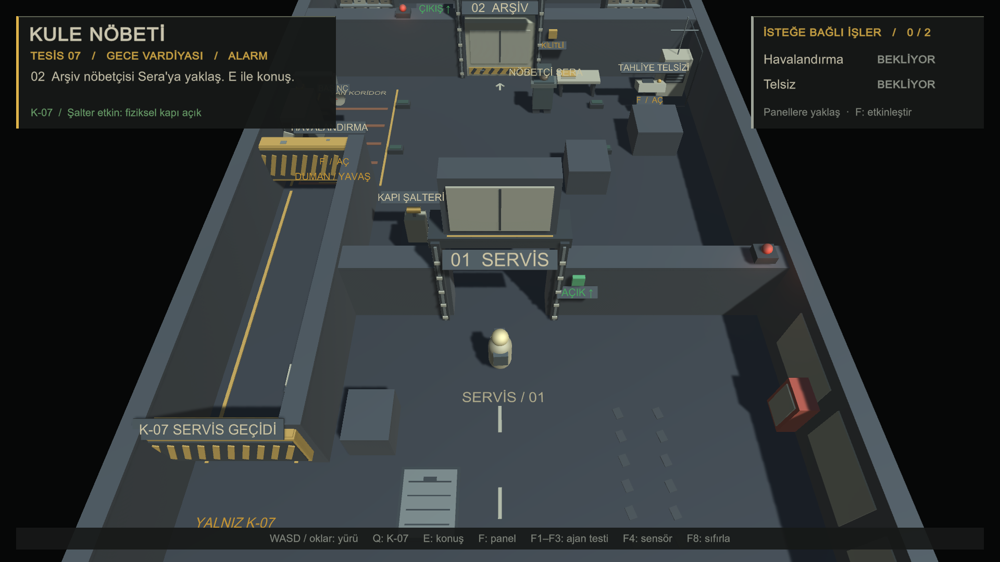
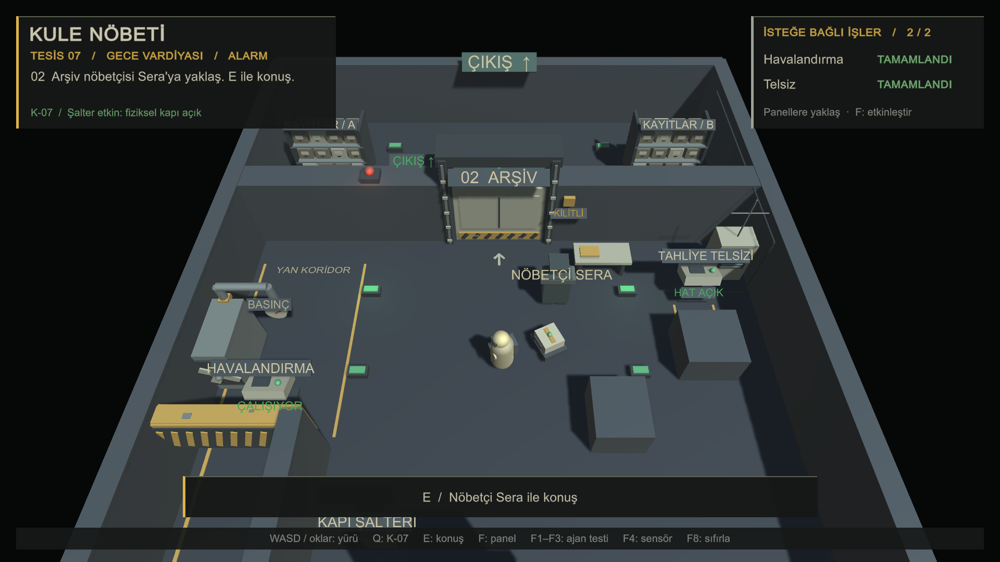
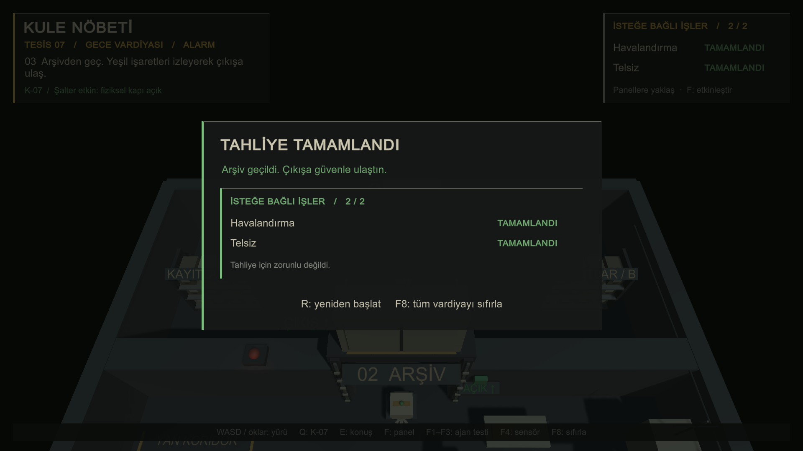

# İstasyon görevleri ve görsel yenileme

Sahne `Assets/Scenes/KuleNobeti.unity` içindeki `StationGame` bileşeninden, Play başladığında `StationWorld.Build()` ile üretilir. Editörde boş görünen sahneye dekor elle yerleştirmek gerekmez. `StationDecor` basit geometrilerle tesis donanımını kurar; yeni dekorun çarpıştırıcıları kapalıdır ve NavMesh kaynaklarına eklenmez. Önceki sahnenin fiziksel duvar, tünel kirişi, sandık, kapı ve şalter konumları korunur.

Kömür grisi metal, kirli krem paneller ve aşınmış sarı güvenlik boyası tesisin ortak paletidir. Amber/kırmızı arıza ve tehlikeyi, yeşil çalışan sistemleri ve gerçek çıkış yönünü belirtir. Oyuncu bakım tulumu ve çantasıyla; Sera uzun paltosu, geniş omuzları ve şapkasıyla ayırt edilir.

## Oyunda nerede görülür?

- Başlangıç ve servis kapısı: bakım kapakları, tekerlek izleri, sarı şeritli alçak K-07 geçidi; kapıda yukarı açılan kanada eşlik eden raylar ve kilit göstergesi.
- İlk kapı sonrası sol: borular, fan ve basınç saati havalandırmayı tanıtır. İşaretli sol yan koridor, havalandırma kapalıyken tehlikelidir ve hareket hızını %48'e düşürür. Ana rota açık kalır.
- İlk kapı sonrası sağ: anten ve kablo hattı telsizi tanıtır. Telsiz çıkış yönündeki kılavuz aydınlatmasını çalıştırır.
- Arşiv: 02 kapı numarası, raf ve dosya kutuları. Yeşil işaretler kuzeydeki gerçek çıkışa yönelir.
- HUD ve bitiş: iki isteğe bağlı iş ayrı satırlarda gösterilir; tamamlanmayan işler tahliyeyi engellemez.

## Elle kontrol

1. **Ek görev yapmadan:** F8 → Q. K-07'nin alçak tünelden geçip şalteri çalıştırmasını bekle. İlk kapıdan, ana koridordan Sera'ya git; E ile gerçek tahliye planını yaz, Enter ile gönder. Yerel Ollama'nın onayıyla arşiv açıldıktan sonra Esc, ardından yeşil çıkış. Bitiş ekranında **0/2**, iki iş de **ATLANDI** olmalı.
2. **İki panelle:** F8 → Q. İlk kapıdan sonra soldaki havalandırmaya yaklaş; F öncesi işaretli yan koridorda yavaşlamayı, F sonrası tehlikenin ve yavaşlamanın kalkmasını kontrol et. Sağdaki antenli telsize yaklaş, F ile etkinleştir; çıkış yönü ışıkları yanmalı. Sera ile aynı gerçek tahliye akışını tamamla. Bitiş **2/2** ve iki iş **TAMAMLANDI** göstermeli.
3. **Sıfırlama:** Paneller açıkken, konuşma sırasında ve bitiş ekranında F8 dene. Kapılar kapalı, iki iş bekliyor, sol koridor tehlikeli ve telsizin kılavuz ışıkları sönük başlamalı. Oyuncu ve K-07 başlangıca dönmeli.
4. **Mevcut kontroller:** Her deneme için F8 → F1/F2/F3 → Q; F4 ile gerçek sensör ölçümlerini aç. Oyuncu kapalı bariyeri ve alçak tüneli aşamamalı. E/Enter/Esc ile serbest metin diyalogu; ilgisiz mesajda arşiv kilitli kalmalı.

Geçerli örnek: “Jeneratör duman çıkarıyor. İçeridekileri acil çıkıştan güvenli alana götürüp orada toplayacağım.” Yeni görevler Ollama istemini, JSON ayrıştırmasını veya tahliye kuralını değiştirmez.

## Otomatik kontrol ve build

Unity'de oyun sahnesi açık ve kaydedilmişken **YazLab → 6 - İstasyon Akışlarını Kontrol Et** menüsü kullanılabilir. Yerel Ollama ve model çalışmalıdır. Bu kontrol gerçek NavMesh ve diyalog bileşenlerini kullanır; fiziksel klavye tuşlarıyla elle yapılan turdan ayrı değerlendirilir. Çalışma raporu `Logs/StationFlowChecks.txt` dosyasına yazılır. Çalıştırılmamış veya başarısız adımlar geçmiş sayılmaz.

**YazLab → 4 - Windows Build Al**, yeni önizlemeyi `Builds/Windows-Istasyon/<tarih-saat>/` altında oluşturur. Önceden test edilmiş `Builds/Windows/` değiştirilmez. `Tools/TeslimPaketi.ps1` önceki teslim klasörünü paketlemeye devam eder; yeni önizleme ayrıca test edilip bilinçli olarak teslim seçilmelidir.

Bu çalışma için Windows derlemesi başarıyla üretildi: **`Builds/Windows-Istasyon/20261105-172205/KuleNobeti.exe`**. Yeni EXE içinde tam oyun turu yapılmadı. Önceki `Builds/Windows` teslimindeki 134 dosyanın SHA-256 değerleri değişmedi; başlangıçta düzenlenmiş iki `ProjectSettings` dosyası da aynı kaldı. Mevcut `main` dalında çalışıldı; stage, commit, dal/worktree veya push işlemi yapılmadı.

## Değişen dosyalar

| Dosya | Değişiklik |
| --- | --- |
| `Assets/Scripts/StationWorld.cs` | Tesis paleti, ışık, karakter siluetleri ve yeni sistemlerin bağlantısı. |
| `Assets/Scripts/StationDecor.cs` + `.meta` (yeni) | Çarpışmasız donanım, tabelalar, kapı rayları, durum ve yön ışıkları. |
| `Assets/Scripts/StationTasks.cs` + `.meta` (yeni) | İsteğe bağlı havalandırma/telsiz durumu, yakınlık ve etkileşim koşulları. |
| `Assets/Scripts/PlayerMotor.cs` | Yalnız işaretli tehlike bölgesinde havalandırma açılana kadar yavaşlama. |
| `Assets/Scripts/StationHud.cs` | Tesis HUD'u, F/E/Q ipuçları, konuşma ve bitiş görev özeti. |
| `Assets/Scripts/StationGame.cs` | Tesis arka plan rengi; F8/R için ortak sahne sıfırlama işleyicisi. |
| `Assets/Editor/StationEditor.cs` | Eski teslimin üzerine yazmayan tarihli Windows önizleme çıktısı. |
| `Assets/Editor/StationFlowChecks.cs` + `.meta` (yeni) | Unity Play modunda gerçek bileşenlerle akış kontrolü ve tek kullanımlık yerel test/build isteği. |
| `README.md`, `docs/istasyon-gorevleri.md` | Kontroller, yeni build yolu, uygulama ve doğrulama notları. |
| `docs/istasyon-gorevleri/` (yeni) | Son kaynaktan üç Unity görüntüsü ve ham kontrol raporu. |

## Bu değişiklikte doğrulama

5 Kasım 2026, **17.21 (İstanbul)**: Unity **6000.0.58f2** Play modunda, gerçek NavMesh ve yerel **qwen2.5:3b** ile son kaynak üzerinde kontrol tamamlandı. [Ham doğrulama raporu](istasyon-gorevleri/dogrulama.txt).

| Kontrol | Sonuç |
| --- | --- |
| Ek görev yapmadan, canlı Ollama/JSON onayıyla arşivden yürüyerek bitiş | Geçti; 0/2 |
| İki paneli etkinleştirip canlı Ollama/JSON onayıyla yürüyerek bitiş | Geçti; 2/2 |
| F8'in kullandığı `StationGame.Restart()` ile iki bitişten ve robot turundan sonra sahneyi yeniden yükleme | Üçü de geçti; kapılar, görevler, diyalog, ışıklar ve tehlike sıfırlandı |
| F1–F3'ün kullandığı gerçek başlangıçlardan Q'nun `Order()` akışı | Üçü de geçti; robot alçak tünelden geçti ve sensör şalteri doğruladı |
| İlk kapı öncesi/uzaktan/konuşma sırasında etkileşimin reddi ve tekrar etkinleştirmede sayının artmaması | Geçti |
| Havalandırma sonrası canlı tehlike durumunun temizlenmesi; telsizin 4 gerçek ışığı ve 8 yön göstergesinin etkinleşmesi | Geçti |
| Yeni dekor çarpıştırıcılarının kapalı olması | Geçti |

Toplam **16 otomatik kontrol geçti**. Bu kontroller üretim bileşenlerinin işleyicilerini çağırır; yürüyüş gerçek `CharacterController.Move` çarpışmalarıyla yapılır. **Fiziksel Q/E/F/F1–F4/F8/R tuş olayları, gerçek WASD ile hız ölçümü ve yeni Windows EXE içinde tam oyun turu çalıştırılmadı; geçmiş sayılmadı.** F4 ekranı kaynakta korunmuştur, fiziksel tuşla açılma kontrolü elle yapılmalıdır. README'deki eski Windows build ölçümleri bu sürümün yeni test kanıtı değildir.

Son görsel düzenlemenin gerçek Unity görüntüleri:

