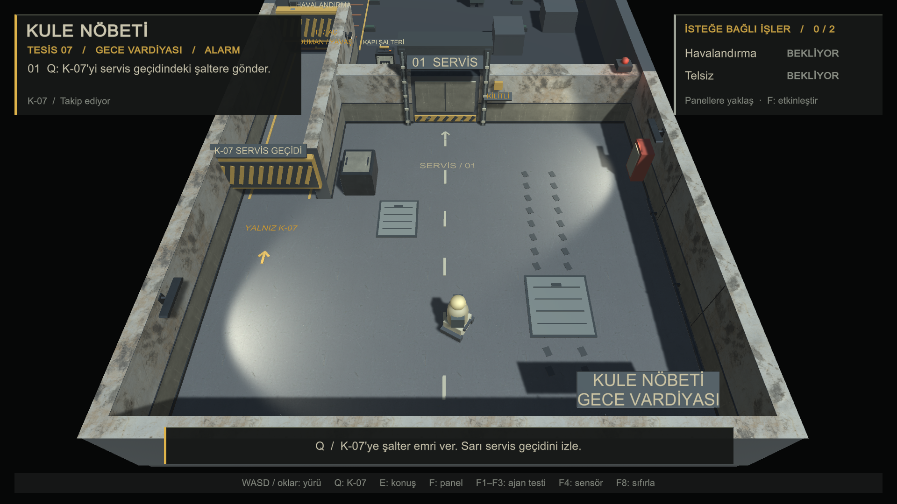
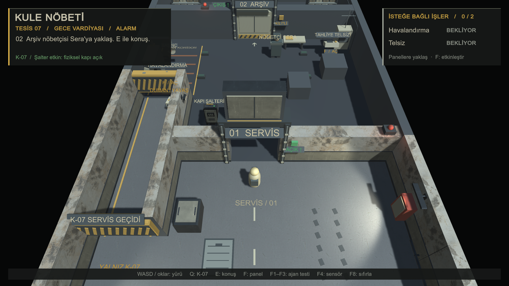
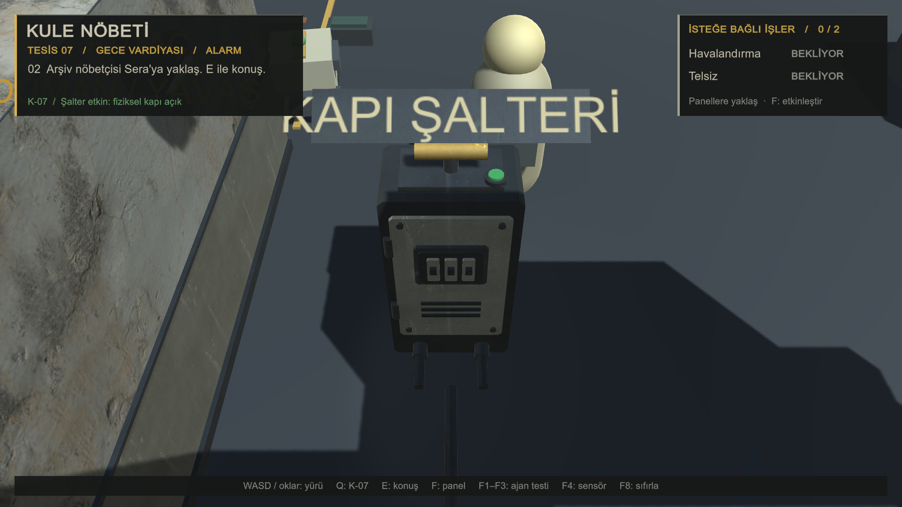

# İlk servis odası

Bu tur yalnız başlangıç servis odasını ve mevcut şalterin elektrik panosu görünümünü yükseltir. Diğer odaların tasarımı, kamera, K-07, oyuncu/Sera görselleri, hareket ve oyun kuralları korunur. Önceki konuşma arayüzü düzenlemesi olan `StationHud.cs` bu turda değiştirilmemiştir.

## İlk fark ve kontroller

Unity'de `Assets/Scenes/KuleNobeti.unity` sahnesini açıp Play'e bas. Sahne çalışma anında üretilir; değişikliği ilk doğuş konumunda beton zemin, boyalı alt duvar sacı, beton üst duvar ve iki duvar armatüründe görürsün. Zemin ve duvar betonlarında **3 m**, boyalı metalde **1 m** tekrar ölçeği kullanılır. Normal ve pürüzlülük haritaları çalışma ışıklarında yüzeyi belirginleştirir.

- **Q:** K-07 sarı alçak geçitten geçer, aynı sensör hedefindeki şalteri çalıştırır. Pahlı elektrik panosunda üst kol, kapak/conta, vidalar, menteşeler, havalandırma yarıkları, üç sigorta ve kablo rakorları bulunur. Gösterge amberden yeşile döner.
- **F1/F2/F3 → Q:** Her sıfırlamadan sonra robotun üç başlangıcını dene. **F4** ile sensör ölçümlerini aç. İnsan alçak geçidi kullanamamalı; yeni kaplama robotu veya ışınları engellememeli.
- **F:** İlk kapıdan sonraki havalandırma ve telsiz görevleri aynı şekilde çalışır.
- **E / Enter / Esc:** Sera ile yerel Ollama konuşması ve arşiv onayı aynı kalır. Geçerli planla hem görevleri atlayarak hem iki görevi yaparak çıkışa git.
- **F8:** Kapılar, şalter/pano göstergesi, iki görev ve ışıklar başlangıca dönmeli.

İlk oda ve geçitlerin kaplamaları ayrı, çarpıştırıcısız mesh'lerdir. Özgün duvar, zemin, kapı, kasa ve şalter çarpışmaları taşınmaz. NavMesh yalnız önceki geometriden üretilmeye devam eder. Kapı sac yüzeyi hareketli kapıya bağlıdır ve özgün parent ölçeği telafi edildiğinden gerçek metre ölçüsünü korur. Eski şalter/kasa yalnız renderer düzeyinde gizlenir; sensör collider'ı durur.

## İnsan modeli ve animasyon durumu

Başlangıç taramasında kullanılabilir insan modeli, prefab, Avatar, `.anim` veya Animator Controller bulunmadı. Bu nedenle yeni insan modeli bağlanmadı, yürüme/durma animasyonu eklenmedi ve yeni kapsül/kutu insan tasarlanmadı.

Gerekenler: **`Player.fbx`, `Sera.fbx`** (tercihen rig'li, Humanoid uyumlu; metre ölçeğinde), varsa **`Player_Idle.fbx`, `Player_Walk.fbx`** (yerinde döngü); PNG/TGA dokular ve kaynak/lisans dosyası. Ayrıntılı konum ve hazırlama şartları [varlık notunda](../Assets/Art/ServiceRoom/README.md#eksik-insan-modelleri) bulunur.

## Kaynak, lisans ve dosyalar

Eklenen dokular Poly Haven'dan **CC0 1.0**: Concrete Floor Worn 001, Concrete Wall 003 ve Green Metal Rust. Yazarlar, kaynak sayfaları ve lisans bağlantıları [Assets/Art/ServiceRoom/README.md](../Assets/Art/ServiceRoom/README.md) içinde; dokuz indirmenin doğrudan URL, fiziksel ölçü ve doğrulanmış hash kayıtları [Sources.json](../Assets/Art/ServiceRoom/Sources.json) içindedir. JPG'ler yeniden boyanmamıştır; metal rengi shader içinde uyarlanır. Oyun harici sunucudan doku indirmez.

| Dosya/grup | Bu turdaki değişiklik |
| --- | --- |
| `Assets/Scripts/ServiceRoomVisual.cs` + `.meta` | İlk odanın metre UV'li görsel yüzeyleri, pahlı donanım, elektrik panosu ve yerel ışıklar. |
| `Assets/Scripts/StationWorld.cs` | Görsel katmanın tek satırlık kurulumu; fizik/NavMesh/karakter üretimi aynı. |
| `Assets/Scripts/StationDecor.cs` | Yeni pano ve kaplamayla çakışan eski basit şalter parçaları ve dört düz duvar paneli kaldırıldı. |
| `Assets/Art/ServiceRoom/` | Dokuz lisanslı PBR JPG, shader, kaynak/lisans kayıtları ve Unity `.meta` dosyaları. |
| `Assets/Resources/ServiceRoom/` | Altı yeniden kullanılabilir yüzey materyali. |
| `Assets/Editor/ServiceRoomAssets.cs` + `.meta` | Sınırlı doku import ayarları ve eksik materyalleri hazırlama menüsü; var olan materyal ayarlarını yeniden yazmaz. |
| `docs/servis-odasi*` | Normal kamera görüntüleri, açıkça işaretli yakın plan ve doğrulama raporları. |

## Doğrulama

Son kaynak üzerinde Unity **6000.0.58f2** Play modunda yapılan oda kontrolünde **10 adım geçti**: shader/malzeme ve import ayarları, çarpıştırıcısız görseller, mevcut insan hiyerarşisinin korunması, beş gerçek ekran görüntüsü, gerçek K-07 NavMesh geçişi ve sensörle fiziksel kapının açılması. [Oda kontrolü ham raporu](servis-odasi/oda-kontrolu.txt). Testte konumlandırma için oyuncu geçici olarak taşınır; fiziksel WASD turu olarak sayılmaz. Yakın plan yalnız kalite kontrolü içindir.

5 Kasım 2026 **18.58 (İstanbul)**: Son kaynak üzerinde genel akıştaki **16 kontrol de geçti**. Üç gerçek robot başlangıcından alçak tünel/şalter, 0/2 ve 2/2 görevle canlı yerel **qwen2.5:3b** üzerinden JSON/tahliye onayı ve yürüyerek bitiş, havalandırma/telsiz etkileri ve üç sahne sıfırlaması doğrulandı. [Genel akışın ham raporu](servis-odasi/akis-kontrolu.txt).

Fiziksel klavye tuşları ve Windows EXE içinde bu tur elle test edilmiş sayılmaz. İnsan modeli/animasyonu yokken bağlama yapılmış veya test edilmiş sayılmaz. Önceki Windows tesliminin 134 dosyasının hash'i ve önceki `StationHud.cs` düzenlemesinin hash'i değişmedi; yeni build bu tur oluşturulmadı. Mevcut dal korundu; stage, commit veya push yapılmadı.
